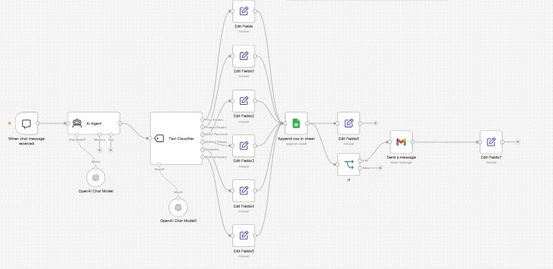

# SmartBuy-AI Customer Service V1

**AI-Powered Customer Service Automation | n8n | OpenAI | Google Sheets | Gmail | Google Apps Script**

**Project Status:** V1 Development and Testing  
**Project Type:** AI Automation / Customer Service  
**Version:** 1.0 (Development)

---

## 1. Project Overview

SmartBuy-AI is an AI-powered customer service automation system designed to help businesses respond to customer enquiries, classify messages, maintain conversation records, and escalate complaints requiring human intervention.

The system uses n8n to connect artificial intelligence with Google Sheets, Gmail, and Google Apps Script.

Its objective is to reduce repetitive customer service tasks while ensuring that complex complaints can receive human attention.

## 2. Project Objectives

- Automate responses to routine customer enquiries.
- Classify customer messages into relevant categories.
- Record customer conversations in Google Sheets.
- Identify enquiries requiring human follow-up.
- Send escalation notifications through Gmail.
- Track complaint resolution status.
- Record when complaints are resolved and by whom.

## 3. Technology Stack

| Technology | Purpose |
|---|---|
| n8n | Workflow automation and orchestration |
| OpenAI | AI-powered customer responses and classification |
| Google Sheets | Conversation logging and complaint tracking |
| Gmail | Human escalation notifications |
| Google Apps Script | Automatic resolution timestamp management |
| GitHub | Version control and project documentation |

## 4. Workflow Architecture

The SmartBuy-AI workflow includes the following major stages:

1. Customer submits a message through the n8n chat interface.
2. The AI Agent processes the customer enquiry.
3. A Text Classifier identifies the message category.
4. The workflow routes the enquiry through the relevant processing branch.
5. Google Sheets records the customer message, AI response, intent, and status.
6. Enquiries requiring human intervention are routed for escalation.
7. Gmail sends a notification when the escalation conditions are met.
8. Human agents update complaint statuses in Google Sheets.
9. Google Apps Script records resolution timestamps and clears resolution details when complaints are reopened.

## 5. Customer Enquiry Classification

The system uses six customer enquiry categories.

Each category has a corresponding processing branch in the n8n workflow.

The classification stage helps organize customer messages and supports appropriate follow-up actions.

## 6. Google Sheets Integration

Customer interactions are recorded in the spreadsheet:

**SmartBuy Lagos – Customer Chat History**

The spreadsheet contains the following fields:

| Column | Field | Description |
|---|---|---|
| A | Timestamp | Time the customer interaction was recorded |
| B | Session_ID | Identifier associated with the chat session |
| C | Customer_Message | Customer's submitted message |
| D | AI_Response | AI-generated response |
| E | Intent | Classified customer enquiry |
| F | Status | Current handling status |
| G | Resolved_At | Date and time of resolution |
| H | Resolved_By | Name of the resolving agent |

## 7. Complaint Status Tracking

The system supports three operational statuses:

**Answered:** The enquiry has received an automated response.

**Pending Human Follow-up:** The enquiry requires attention from a human customer service agent.

**Resolved:** The complaint has been handled and marked as resolved.

Human agents can update these statuses directly in Google Sheets.

## 8. Automatic Resolution Tracking

A Google Apps Script monitors manual edits to the Status column.

When a complaint is marked **Resolved**, the script:

- Automatically records the resolution date and time.
- Preserves the timestamp as a fixed value.
- Allows the responsible agent to enter their name manually.

When the complaint status changes away from Resolved, the script:

- Clears the resolution timestamp.
- Clears the previously recorded agent name.

Resolution timestamps are displayed using the spreadsheet's Lagos timezone configuration.

## 9. Testing and Validation

The following development tests have been completed:

| Test Scenario | Expected Result | Status |
|---|---|---|
| Customer product enquiry | AI generates an appropriate response | Tested |
| Customer message logging | Conversation recorded in Google Sheets | Tested |
| Enquiry classification | Intent recorded in Google Sheets | Tested |
| Complaint escalation | Human follow-up workflow activated | Tested |
| Change status to Resolved | Resolution timestamp generated | Passed |
| Enter resolving agent | Agent name recorded | Passed |
| Reopen complaint | Resolution timestamp cleared | Passed |
| Reopen complaint | Resolving agent name cleared | Passed |

These tests demonstrate selected workflow functions. Additional testing is required before production deployment.

## 10. Known Limitations

- The current chat interface is a development and testing channel.
- AI-generated responses require appropriate business information and verification.
- The resolution tracker responds to manual Google Sheets edits, not updates made through the n8n Google Sheets integration.
- Agent names are entered manually.
- Advanced authentication, access controls, and production monitoring are not yet implemented.
- The system requires additional security and reliability testing before handling live customer data.

## 11. Planned Improvements

Future development may include:

- Customer-facing web chat integration.
- Improved knowledge-base management.
- Automated complaint assignment.
- Agent authentication and accountability.
- Complaint response-time monitoring.
- Customer service performance dashboards.
- Additional integrations with business systems.

## 12. Project Documentation

This repository is intended to contain:

- SmartBuy-AI workflow documentation.
- A workflow architecture screenshot.
- A reviewed, importable n8n workflow JSON file.
- Google Apps Script source code.
- Installation and configuration instructions.
- Test scenarios and development milestones.

## 13. Project Status

**SmartBuy-AI Customer Service V1 — Development and Testing**

The core customer service workflow and manual resolution tracking have been demonstrated. Further validation, documentation, and production safeguards remain necessary.

---

*Developed as a practical AI automation project using n8n, OpenAI, Google Workspace, and GitHub.*

## Installation and Setup

### Prerequisites

Before importing SmartBuy-AI, ensure you have:

- An n8n Cloud account or a self-hosted n8n installation.
- Access to an OpenAI chat model supported by your n8n environment.
- A Google account with Google Sheets access.
- A Gmail account for human follow-up notifications.

### Importing the Workflow

1. Download `SmartBuy-AI-Workflow-Public.json` from this repository.
2. Sign in to your n8n account.
3. Create a new workflow.
4. Open the workflow menu and select **Import from File**.
5. Select the downloaded JSON file.
6. Confirm that the workflow nodes appear in the n8n editor.

### Configuring the Integrations

**OpenAI**

Configure the OpenAI Chat Model nodes using a supported model and the appropriate credentials or managed connection.

**Google Sheets**

1. Create a Google spreadsheet for customer enquiry logging.
2. Add the following column headings:

   `Timestamp | Session_ID | Customer_Message | AI_Response | Intent | Status | Resolved_At | Resolved_By`

3. Connect your Google Sheets account in n8n.
4. Update the **Append row in sheet** node to reference your spreadsheet and worksheet.
5. Verify the column mappings.

**Gmail**

1. Connect your Gmail account in n8n.
2. Open the **Send a message** node.
3. Replace the placeholder recipient with your authorized human support email address.
4. Test the notification using a sample customer complaint.

### Testing

Send sample customer messages covering price enquiries, product availability, orders, delivery questions, complaints, and general enquiries.

Confirm that:

- The AI responds appropriately.
- Enquiries are classified correctly.
- Customer interactions are recorded in Google Sheets.
- Enquiries requiring human attention are marked `Pending Human Follow-up`.
- Escalation emails are sent to the configured recipient.

### Resolution Tracking

The Google Apps Script resolution tracker is a separate component and is not included in the n8n workflow JSON.

It must be configured separately to record resolution timestamps when an authorized user manually changes a customer enquiry's status to `Resolved`.

### Security Notes

Do not commit API keys, OAuth tokens, customer information, or private spreadsheet configuration to a public repository.

Use your own credentials and verify all integration settings before activating the workflow.
