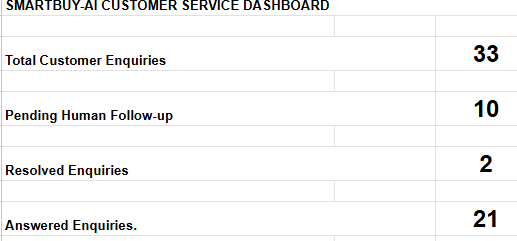
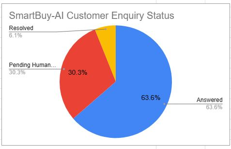
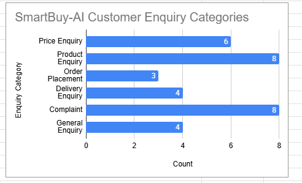
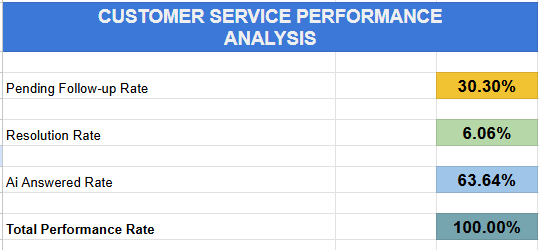

# SmartBuy-AI Customer Service — V1.1 Analytics Dashboard

## 1. Project Overview

**Project Name:** SmartBuy-AI Customer Service Automation

**Version:** 1.1 — Analytics Dashboard

**Business:** SmartBuy Lagos (Fictional Retail Business)

**Technology:** n8n, OpenAI, Google Sheets, Gmail and Google Apps Script

### Project Description

SmartBuy-AI is an AI-powered customer service automation system designed to receive customer enquiries, generate AI responses, classify enquiries into six categories, record customer interactions and notify human operators when follow-up is required.

Version 1.1 introduces a Google Sheets Analytics Dashboard that provides a visual overview of customer enquiries and customer service performance.

### Objectives

- Monitor the total number of customer enquiries.
- Track answered, pending and resolved enquiries.
- Analyse enquiries across six categories.
- Display customer service information using charts.
- Calculate customer service performance indicators.
- Automatically update dashboard figures when customer records change.

### Key Benefits
The dashboard helps a retail business understand customer enquiry patterns, identify outstanding follow-ups and monitor customer service activity without manually counting spreadsheet records.

## 2. Google Sheets Data Structure

### 2.1 Spreadsheet

**Spreadsheet Name:** SmartBuy Lagos-Customer Chat History

The spreadsheet contains two worksheets:

1. Chat History
2. Dashboard

### 2.2 Chat History Worksheet

The Chat History worksheet serves as the main database for customer interactions.

| Column | Field Name | Description |
|---|---|---|
| A | Timestamp | Date and time the customer enquiry was recorded |
| B | Session_ID | Identifier associated with the customer chat session |
| C | Customer_Message | Original message submitted by the customer |
| D | AI_Response | Response generated by the AI Agent |
| E | Intent | Customer enquiry category assigned by the classification workflow |
| F | Status | Current enquiry status: Answered, Pending Human Follow-up or Resolved |
| G | Resolved_At | Date and time an enquiry was marked as resolved |
| H | Resolved_By | Person responsible for resolving the enquiry |

### 2.3 Customer Enquiry Categories

SmartBuy-AI classifies customer enquiries into six categories:

1. Price Enquiry
2. Product Enquiry
3. Order Placement
4. Delivery Enquiry
5. Complaint
6. General Enquiry

These categories are used by the dashboard to analyse customer demand.

### 2.4 Dashboard Worksheet

The Dashboard worksheet reads information from the Chat History worksheet using Google Sheets formulas.

It provides:

- Customer enquiry summary metrics
- Customer enquiry status pie chart
- Customer enquiry category bar chart
- Customer service performance indicators
- Classification completeness checks

The dashboard updates automatically when the underlying customer enquiry records change.

## 3. Google Sheets Dashboard Formulas

### 3.1 Overview

The SmartBuy-AI V1.1 Analytics Dashboard uses Google Sheets formulas to calculate customer enquiry statistics automatically.

The main functions are:

- **COUNTA:** Counts cells containing information.
- **COUNTIF:** Counts cells matching a specified condition.
- **SUM:** Adds numerical values.
- **IFERROR:** Handles formula errors by displaying an alternative value.

### 3.2 Customer Enquiry Summary Formulas

| Metric | Dashboard Cell | Formula |
|---|---|---|
| Total Customer Enquiries | C3 | `=COUNTA('Chat History'!C2:C)` |
| Pending Human Follow-up | C5 | `=COUNTIF('Chat History'!F2:F,"Pending Human Follow-up")` |
| Resolved Enquiries | C7 | `=COUNTIF('Chat History'!F2:F,"Resolved")` |
| Answered Enquiries | C9 | `=COUNTIF('Chat History'!F2:F,"Answered")` |

These formulas automatically calculate enquiry totals using the Chat History worksheet.

### 3.3 Customer Enquiry Category Formulas

The dashboard counts enquiries across six categories using the Intent field in column E.

| Category | Dashboard Cell | Formula |
|---|---|---|
| Price Enquiry | B38 | `=COUNTIF('Chat History'!E2:E,A38)` |
| Product Enquiry | B39 | `=COUNTIF('Chat History'!E2:E,A39)` |
| Order Placement | B40 | `=COUNTIF('Chat History'!E2:E,A40)` |
| Delivery Enquiry | B41 | `=COUNTIF('Chat History'!E2:E,A41)` |
| Complaint | B42 | `=COUNTIF('Chat History'!E2:E,A42)` |
| General Enquiry | B43 | `=COUNTIF('Chat History'!E2:E,A43)` |

**Total Classified Enquiries (B44):**

`=SUM(B38:B43)`

**Unclassified Enquiries (B45):**

`=COUNTA('Chat History'!C2:C)-SUM(B38:B43)`

The unclassified calculation identifies customer messages whose Intent values are not counted among the six recognised categories.

### 3.4 Customer Service Performance Formulas

| Indicator | Dashboard Cell | Formula |
|---|---|---|
| Pending Follow-up Rate | C67 | `=IFERROR(C5/C3,0)` |
| Resolution Rate | C69 | `=IFERROR(C7/C3,0)` |
| AI Answered Rate | C71 | `=IFERROR(C9/C3,0)` |
| Total Performance Rate | C73 | `=SUM(C67,C69,C71)` |

The performance indicators are formatted as percentages.

### 3.5 Formula Explanation

**Example 1: COUNTIF**

`=COUNTIF('Chat History'!E2:E,A38)`

This searches the Intent column and counts how many enquiries match the category specified in cell A38.

**Example 2: IFERROR**

`=IFERROR(C5/C3,0)`

This divides pending enquiries by total enquiries. If the calculation produces an error, the formula displays zero instead.

**Example 3: SUM**

`=SUM(B38:B43)`

This adds the counts for all six customer enquiry categories.

### 3.6 Automatic Updates

The dashboard formulas reference the Chat History worksheet directly.

When new customer enquiries are recorded or existing records are updated, the dashboard automatically recalculates the relevant metrics.

The pie chart and bar chart use these calculated values to display updated customer service information.

## 4. Dashboard Charts and Performance Indicators

### 4.1 Customer Enquiry Status Pie Chart

**Chart Title:** SmartBuy-AI Customer Enquiry Status

**Chart Type:** Pie Chart

**Data Source:** Dashboard cells E3:F6

The pie chart displays the distribution of customer enquiries across three status categories:

| Status | Count | Percentage |
|---|---:|---:|
| Answered | 21 | 65.63% |
| Pending Human Follow-up | 9 | 28.13% |
| Resolved | 2 | 6.25% |
| **Total** | **32** | **100%** |

**Purpose:** To provide a visual summary of customer enquiry statuses and identify enquiries requiring human attention.

### 4.2 Customer Enquiry Category Bar Chart

**Chart Title:** SmartBuy-AI Customer Enquiry Categories

**Chart Type:** Horizontal Bar Chart

**Data Source:** Dashboard cells A37:B43

The bar chart displays the number of enquiries in each of the six customer enquiry categories.

| Category | Count |
|---|---:|
| Price Enquiry | 6 |
| Product Enquiry | 8 |
| Order Placement | 3 |
| Delivery Enquiry | 3 |
| Complaint | 8 |
| General Enquiry | 4 |
| **Total** | **32** |

**Purpose:** To identify the most common types of customer enquiries.

Product Enquiry and Complaint were the most frequent categories in the test dataset, with eight enquiries each.

### 4.3 Customer Service Performance Indicators

The dashboard calculates three performance indicators:

**Pending Follow-up Rate**

Percentage of all recorded enquiries awaiting human attention.

Formula: `=IFERROR(C5/C3,0)`

Baseline result: 28.13%

**Resolution Rate**

Percentage of all recorded enquiries explicitly marked Resolved.

Formula: `=IFERROR(C7/C3,0)`

Baseline result: 6.25%

**AI Answered Rate**

Percentage of all recorded enquiries with the status Answered.

Formula: `=IFERROR(C9/C3,0)`

Baseline result: 65.63%

The Answered status does not independently establish whether the customer was satisfied or whether the enquiry was fully resolved.

### 4.4 Performance Verification

The Total Performance Rate is calculated using:

`=SUM(C67,C69,C71)`

Baseline result: 100%

This verifies that the three recorded status categories account for all 32 enquiries in the baseline dataset.

### 4.5 Dashboard Colour Coding

| Indicator | Colour | Meaning |
|---|---|---|
| Pending Follow-up Rate | Orange | Awaiting human attention |
| Resolution Rate | Green | Marked Resolved |
| AI Answered Rate | Blue | Marked Answered |
| Total Performance Rate | Neutral | Verification total |

### 4.6 Automatic Chart Updates

Both charts are linked to formula-driven tables in the Dashboard worksheet.

When customer records are added, edited or removed in Chat History, the relevant counts and chart values update automatically.

## 5. Dashboard Functional Testing

### 5.1 Test Objective

To verify that the SmartBuy-AI V1.1 Analytics Dashboard automatically updates when customer enquiry records are added or removed from the Chat History worksheet.

### 5.2 Baseline Data

Before testing, the dashboard contained:

| Metric | Baseline Value |
|---|---:|
| Total Customer Enquiries | 32 |
| Answered Enquiries | 21 |
| Pending Human Follow-up | 9 |
| Resolved Enquiries | 2 |
| Price Enquiries | 6 |
| Total Classified Enquiries | 32 |
| Unclassified Enquiries | 0 |

### 5.3 Test Procedure

A temporary customer enquiry was manually added to the Chat History worksheet.

**Test Session ID:** `TEST-DASHBOARD-001`

**Customer Message:** How much is the Samsung Galaxy A15?

**Intent:** Price Enquiry

**Status:** Answered

The dashboard was then checked to verify that the relevant metrics updated automatically.

### 5.4 Test Results

| Test Case | Before | After | Result |
|---|---:|---:|---|
| Total Customer Enquiries | 32 | 33 | PASS |
| Answered Enquiries | 21 | 22 | PASS |
| Price Enquiries | 6 | 7 | PASS |
| Pending Human Follow-up | 9 | 9 | PASS |
| Resolved Enquiries | 2 | 2 | PASS |
| Total Classified Enquiries | 32 | 33 | PASS |
| Unclassified Enquiries | 0 | 0 | PASS |

The dashboard charts and performance percentages also updated correctly.

### 5.5 Test Data Cleanup

After completing the test, the temporary record with Session ID `TEST-DASHBOARD-001` was deleted.

The dashboard automatically returned to its original baseline values.

**Final Verification:**

- Total Customer Enquiries: 32
- Total Classified Enquiries: 32
- Unclassified Enquiries: 0
- Total Performance Rate: 100%

### 5.6 Test Conclusion

**Test Status: PASSED**

The dashboard successfully recalculated its metrics and updated its charts when the underlying Chat History data changed.

The temporary test record was removed, and the original dataset was restored.

This test confirms the dashboard's automatic calculation functionality. It does not constitute a full end-to-end test of the n8n workflow or Gmail integration.

## 6. End-to-End Integration Testing

### 6.1 Test Objective

Verify that SmartBuy-AI successfully processes a customer enquiry through n8n, generates an AI response, classifies the enquiry, records it in Google Sheets, updates the Analytics Dashboard and sends a Gmail notification when human follow-up is required.

### 6.2 Test Scenario

**Test Date:** 21 October 2026

**Customer Message:** i am yet to receive my order

**Expected Classification:** Delivery Enquiry

**Expected Status:** Pending Human Follow-up

### 6.3 Test Results

| Test Component | Result |
|---|---|
| Customer chat received by n8n | PASS |
| AI response generated | PASS |
| Delivery Enquiry classification | PASS |
| Pending Human Follow-up status | PASS |
| Google Sheets record created | PASS |
| Analytics Dashboard automatically updated | PASS |
| Gmail human follow-up notification received | PASS |
| Customer message and AI response included in email | PASS |
| Human follow-up instructions included | PASS |

### 6.4 Test Conclusion

**Overall Test Status: PASSED**

The SmartBuy-AI workflow successfully processed a delivery-related customer enquiry and generated the required human follow-up notification.

The Analytics Dashboard also updated automatically after the enquiry was recorded.

This verifies the tested integration between n8n, AI processing, Google Sheets, the Analytics Dashboard and Gmail.

Actual human resolution of the customer enquiry was outside the scope of this test.

## 7. Dashboard Screenshots

The following screenshots demonstrate the SmartBuy-AI V1.1 Analytics Dashboard.

### 7.1 Dashboard Summary

### 7.2 Customer Enquiry Status Pie Chart

### 7.3 Customer Enquiry Category Bar Chart

### 7.4 Customer Service Performance Analysis

